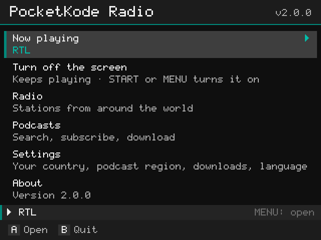
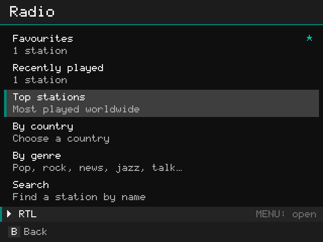
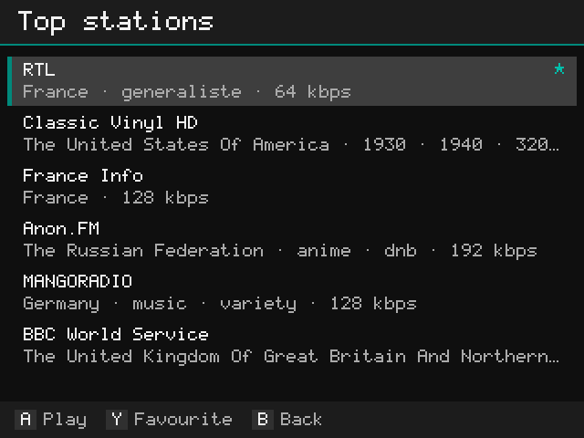
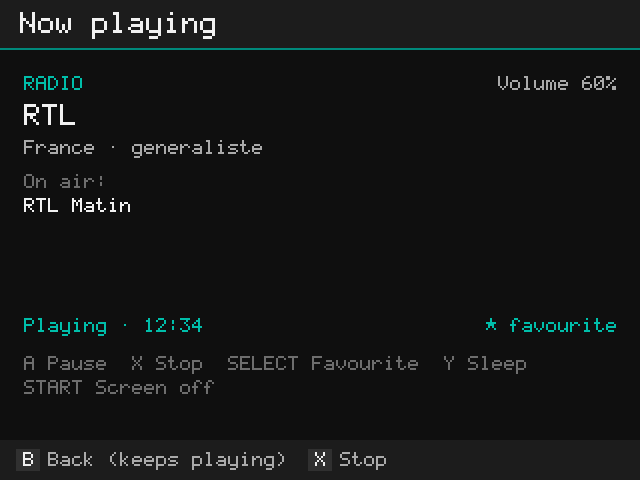
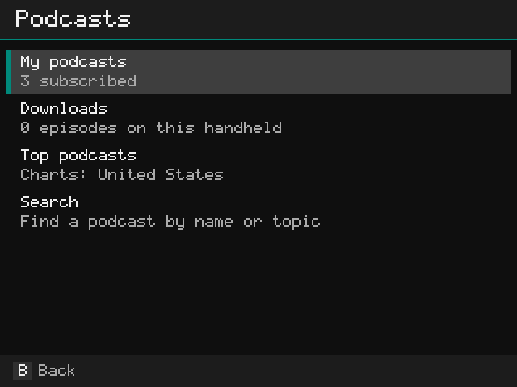
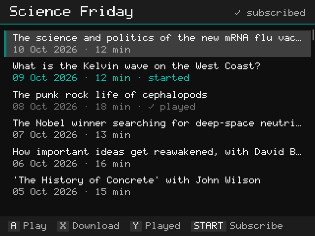
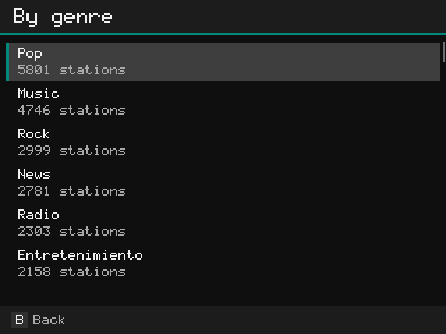

# PocketKode Radio

**Internet radio and podcasts for muOS handhelds**, with the screen off to save battery.

[Download](https://pocketkode.com/apps/pocketkode-radio/) · [Guide](https://pocketkode.com/apps/pocketkode-radio/#guide) ·
[Blog: radio and podcasts on muOS](https://pocketkode.com/blog/internet-radio-podcasts-muos-rg40xxh/) ·
[pocketkode.com](https://pocketkode.com)

***

- **Radio:** thousands of stations from around the world (top stations, by country, by genre, search), favourites,
  recently played and **My country**.
- **Podcasts:** search and charts, subscriptions, downloads that play without Wi-Fi, and where you stopped in every
  episode.
- **Screen off** while it keeps playing, and a **sleep timer**.
- Speeds from 0.75x to 2x for podcasts, and the song or show that's on air for many stations.
- **9 languages:** English, 日本語, Español, Français, Deutsch, Nederlands, Русский, 简体中文 and 한국어.

## Gallery

| | |
|---|---|
|  |  |
|  |  |
|  |  |
|  |  |

## Installation

1. Download `PocketKodeRadio-X.Y.Z.muxapp` from
   **[pocketkode.com/apps/pocketkode-radio](https://pocketkode.com/apps/pocketkode-radio/)** (or from the
   [latest release](https://github.com/pocketkode/pocketkode-radio/releases/latest) here). The SHA-256 is on both pages.
2. Copy it to the `ARCHIVE` folder on SD card 1 (with a card reader, or over Wi-Fi with
   [Wi-Fi Transfer](https://pocketkode.com/apps/wifi-transfer/)).
3. On the handheld, open **Applications → Archive Manager** and install it. Then open **Applications → PocketKode Radio**.

New to `.muxapp` files? See [Install apps on muOS with Archive Manager](https://pocketkode.com/blog/install-apps-muos-archive-manager-muxapp/).

Tested on the Anbernic RG40XXH with muOS 2601.0 Jacaranda.

## Quick start

1. Turn on Wi-Fi in muOS and check that the **date and time** are right.
2. Open **Applications → PocketKode Radio**. **A** opens, **B** goes back. While something plays, **MENU** opens Now
   playing from any screen.
3. **Radio:** Top stations, By country, By genre and Search. **A** plays a station, **Y** adds it to Favourites;
   Recently played keeps your last 15. In By country, **Y** makes a country **My country**: its stations get their own
   entry in the Radio menu.
4. **Podcasts:** search or browse Top podcasts. **Y** subscribes; your shows are in My podcasts. In a show's episodes:
   **A** play · **X** download (again to cancel or delete) · **Y** mark as played.

The full guide is on **[pocketkode.com/apps/pocketkode-radio](https://pocketkode.com/apps/pocketkode-radio/#guide)**.

## Now playing

| | Buttons |
|---|---|
| Always | **A** play / pause · **Y** sleep timer · **START** screen off · **X** stop · **B** back (keeps playing) |
| Radio | **SELECT** favourite |
| Podcast | **◀ ▶** back 15 s / forward 30 s · **L1/R1** speed (0.75x to 2x) · **SELECT** download |

## Tips

- **Screen off:** **START** in Now playing turns the screen off to save battery; the sound keeps playing. **START** or
  **MENU** turns it back on; other buttons don't, so a button pressed in your bag does nothing.
- **Sleep timer:** **Y** in Now playing: 15, 30, 45, 60 or 90 minutes, or off.
- **Volume:** use the handheld's **VOL+ / VOL−** buttons.
- **Downloaded episodes** play without Wi-Fi. **Settings → Delete all downloads** frees space; your subscriptions and
  where you stopped are kept.
- **Settings:** My country, which country's podcast charts you see, the language (Auto follows muOS), and the update check.
- **Updates:** when a new version is out, **Update available** appears on the home screen. Press **A** to update; your
  favourites, podcasts and settings stay.

## Troubleshooting

| Problem | What to do |
|---|---|
| No internet connection | Turn on Wi-Fi in muOS. |
| Secure connection failed | Set the correct date and time in muOS. |
| A station doesn't play | Stations sometimes go offline; try another one, or try again later. |
| Still stuck? | Email **feedback@pocketkode.com** with your handheld and muOS version (and `logs/app.log` from the app's folder), or open an [issue](https://github.com/pocketkode/pocketkode-radio/issues). |

## Privacy

PocketKode Radio never reads or sends your files, and doesn't record anything.

For updates it reads the latest release on GitHub (you can turn this off in **Settings**), and an update you choose to
install is downloaded from pocketkode.com and checked (SHA-256 and PocketKode's signature). It sends nothing about you
or the handheld.

Stations come from **Radio Browser**, podcasts from **Apple's podcast directory**, and the sound from each station or
show itself. Your searches go to those services. When you play a station, Radio Browser is told that the station was
played (an anonymous count that keeps its Top list up to date).

Your favourites, subscriptions and history stay on the handheld. No ads, no analytics, no tracking.
More on [pocketkode.com/privacy](https://pocketkode.com/privacy/).

## Build

`bash build.sh` (needs bash, curl, unzip, zip, shasum and python3) produces `dist/PocketKodeRadio.muxapp`: the app's
Python source as it is, plus the Noto Sans JP, SC and KR fonts. The app uses the Python 3, SDL2, SDL2_ttf and mpv that
come with muOS; its pixel font and SDL2 bindings are its own.

## Third-party components

Bundled in the package, under their own license (texts in the package's `licenses/` folder):

- **Noto Sans JP, SC and KR** ([notofonts/noto-cjk](https://github.com/notofonts/noto-cjk)), © Adobe and Google, SIL
  Open Font License 1.1: the fonts for Japanese, Chinese and Korean, bundled unmodified in `fonts/`.

Used at runtime, not bundled:

- **Radio Browser** ([radio-browser.info](https://www.radio-browser.info)): the community station directory (open data).
- **Apple's podcast directory**: podcast search and charts. Episodes come from each podcast's own feed.
- **mpv**, **SDL2** and **SDL2_ttf**, as shipped with muOS.

Stations and podcasts belong to their broadcasters and creators.

## Acknowledgments

- The [Radio Browser](https://www.radio-browser.info) community, who keep a free, open directory of the world's stations.
- The broadcasters and podcasters who share their shows freely.
- The [mpv](https://mpv.io) and [SDL](https://www.libsdl.org) projects.
- The [muOS](https://muos.dev) team, for the system PocketKode Radio runs on.
- Everyone who reports bugs and ideas.

PocketKode Radio is an independent app, not affiliated with Radio Browser, Apple, any broadcaster or podcast, muOS or
Anbernic.

## License

© 2026 PocketKode. PocketKode Radio is free software under the **GNU General Public License v3** (GPL-3.0-only): you
may use, study, change and share it under that license; see [LICENSE](LICENSE). Bundled third-party parts keep their
own licenses (see the `licenses/` folder).

The name "PocketKode", the name "PocketKode Radio" as used by PocketKode, and the PocketKode and app icons are not
covered by the GPL. If you share a changed version, please give it a different name and icon.

Bug reports and ideas: **feedback@pocketkode.com** · [pocketkode.com](https://pocketkode.com)
